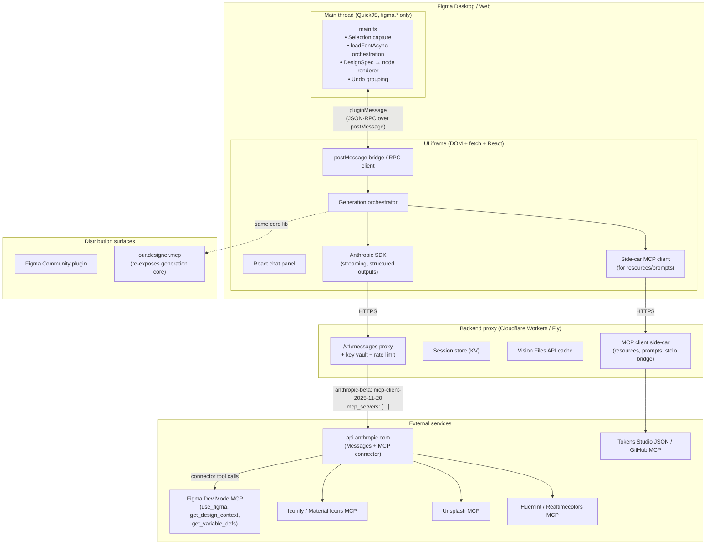
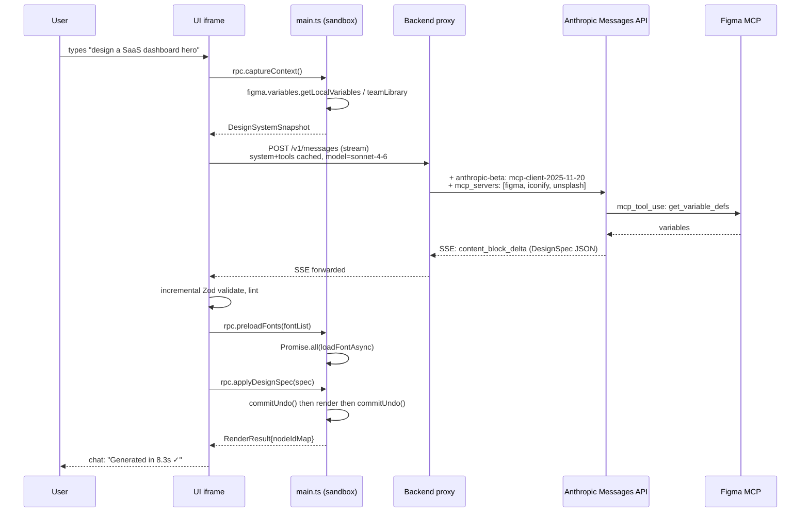
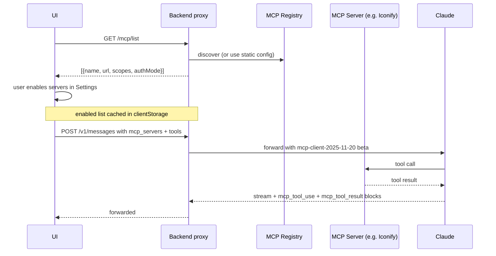

# Designer — Figma AI Plugin Architecture (v1)

> Single source of truth for all subsequent implementation work. Every architectural decision below is grounded in the live research in §0; cite the same source when changing a decision.
> Last reviewed: 2026-05-25. Re-verify all "beta" headers and model IDs before each release.

## Assumptions

1. **Anthropic Messages API + native MCP connector** is the agent transport. Beta header `anthropic-beta: mcp-client-2025-11-20` ([Anthropic MCP connector](https://platform.claude.com/docs/en/agents-and-tools/mcp-connector)).
2. **Default model: Claude Sonnet 4.6** (1M context GA, 64K max output, $3/$15 per MTok, structured-output adherence ≥ 98%) for per-mutation work; **promote to Claude Opus 4.7** (1M context, 128K output, 3.75 MP vision, adaptive thinking, $5/$25) for multi-screen synthesis, code-to-canvas, and brand-QA passes ([Anthropic models overview](https://platform.claude.com/docs/en/about-claude/models/overview), [Anthropic: Claude Opus 4.7](https://www.anthropic.com/news/claude-opus-4-7)).
3. **Plugin authoring**: TypeScript → single bundle, Figma Plugin API v `"1.0.0"`, `documentAccess: "dynamic-page"`, React + Vite in the UI iframe ([figma/plugin-typings `plugin-api.d.ts`](https://github.com/figma/plugin-typings/blob/main/plugin-api.d.ts)).
4. **A backend proxy is mandatory**: clientStorage is not secure and plugin code is fully inspectable, so the Anthropic key never lives in the plugin ([Figma OAuth with Plugins](https://developers.figma.com/docs/plugins/oauth-with-plugins/)).
5. **MCP** is built around the **`2025-11-25` spec** (current shipping) with planned migration to `2026-07-28` once it leaves RC ([MCP spec 2025-11-25](https://workos.com/blog/mcp-2025-11-25-spec-update)).
6. **Manifest `networkAccess.allowedDomains`** explicitly allowlists: our backend, `api.anthropic.com` (for direct streaming if we keep the key BYOK), the Figma MCP host, and asset CDNs (Unsplash, Iconify, etc.). `"*"` is rejected at review ([Making Network Requests](https://developers.figma.com/docs/plugins/making-network-requests/)).
7. **Distribution**: Figma Community public listing + private-org variant. We additionally publish ourselves as an **MCP server** to remain reachable from Cursor, Claude Code, VS Code, and Google Stitch's canvas ([Figma MCP catalog](https://www.figma.com/mcp-catalog/), [Google Stitch with Gemini 3](https://blog.google/innovation-and-ai/models-and-research/google-labs/stitch-gemini-3/)).
8. **Team size**: 1–2 engineers; roadmap is sized accordingly.

---

## 0. Research Summary

### A. Key Technical Constraints (non-obvious limits from live docs)

| # | Constraint | Source |
|---|---|---|
| A1 | Plugin runs in two contexts: a **QuickJS-sandboxed main thread** (no `fetch`/`window`/DOM, only `figma.*`) and an **iframe UI** (full browser APIs). All cross-context traffic is `postMessage` only; functions and prototype chains do not survive structured-clone. | [How Plugins Run](https://developers.figma.com/docs/plugins/how-plugins-run/), [plugin-typings 2671–2675](https://github.com/figma/plugin-typings/blob/main/plugin-api.d.ts) |
| A2 | **All network calls** (Claude, MCP, image fetches) **must originate in the iframe.** The main thread cannot reach `api.anthropic.com`. | [How Plugins Run](https://developers.figma.com/docs/plugins/how-plugins-run/) |
| A3 | `networkAccess.allowedDomains` is a strict allowlist; entries like `"none"` block all egress and `"*"` triggers store review. `devAllowedDomains` extends only at dev time. | [Plugin Manifest](https://developers.figma.com/docs/plugins/manifest/) |
| A4 | `clientStorage` caps at **5 MB total** and is **not a secret store** — "private for stability, not security." | [figma.clientStorage](https://www.figma.com/plugin-docs/api/figma-clientStorage/) |
| A5 | With `documentAccess: "dynamic-page"`, every sync getter (`getNodeById`, style getters, `setCurrentPage`) throws; only `*Async` variants work and we must call `loadAllPagesAsync()` before cross-page work. | [plugin-typings line 417, 1907](https://github.com/figma/plugin-typings/blob/main/plugin-api.d.ts) |
| A6 | **`loadFontAsync` is mandatory before any text mutation** (`characters`, `fontSize`, `fontName`, `setRangeFontName`); throws otherwise. Caches per font but still round-trips the event loop. Use `Promise.all` for bulk loads. | [loadFontAsync](https://www.figma.com/plugin-docs/api/properties/figma-loadfontasync/) |
| A7 | `figma.notify` truncates at 100 chars; default 3 s. UI status messages need their own React surface. | plugin-typings 226–272 |
| A8 | **Anthropic MCP connector supports tools only** (no resources, no prompts), HTTPS Streamable HTTP / SSE only (no stdio), not ZDR-eligible, not on Bedrock/Vertex. | [MCP connector](https://platform.claude.com/docs/en/agents-and-tools/mcp-connector) |
| A9 | Tool-use loop adds ~346 system tokens per request when `tool_choice` is `auto`/`none` (313 for `any`/forced). At Tier 1 (50 RPM / 30k ITPM / 8k OTPM on Sonnet 4.x) a typical generation will saturate quickly — production must target **Tier 3** (2k RPM / 800k ITPM / 160k OTPM). | [Tool use overview](https://docs.claude.com/en/docs/agents-and-tools/tool-use/overview), [Rate limits](https://platform.claude.com/docs/en/api/rate-limits) |
| A10 | **Opus 4.7 returns 400 on `thinking.enabled`** — it uses **adaptive thinking** with an `effort` parameter (`low|medium|high|xhigh`). Sonnet 4.6 and Haiku 4.5 keep manual extended thinking. | [Extended thinking](https://docs.claude.com/en/docs/build-with-claude/extended-thinking), [Opus 4.7 release](https://www.anthropic.com/news/claude-opus-4-7) |
| A11 | **Prompt cache TTL defaults to 5 min** (1 h available at 2× write cost). As of Feb 2026 cache is workspace-scoped, not org-scoped — relevant for multi-tenant proxies. `cache_read_input_tokens` don't count toward ITPM. | [Prompt caching](https://docs.claude.com/en/docs/build-with-claude/prompt-caching) |
| A12 | **Vision** accepts JPEG/PNG/GIF/WebP, max 8000×8000 (auto-down to 2000×2000 if > 20 images); 100 images/request on 200k-ctx models, 600 on others; 32 MB request cap. Files API recommended for repeated reuse. | [Vision](https://docs.claude.com/en/docs/build-with-claude/vision) |
| A13 | **Figma's own Dev Mode MCP server** is live and bidirectional (read: `get_design_context`, `get_variable_defs`; write: `use_figma`; code-to-canvas: `generate_figma_design`). Rate limits: Enterprise 600 calls/day, Org/Pro 200/day, Starter 6/month. | [Figma MCP server](https://developers.figma.com/docs/figma-mcp-server/), [Figma MCP help](https://help.figma.com/hc/en-us/articles/32132100833559) |
| A14 | **May 20, 2026 — Figma launched a native "Design Agent" inside the canvas** with OpenAI + Anthropic models, free during beta. Our positioning must explicitly differentiate from the native agent (not duplicate it). | [Figma blog: The Figma Design Agent](https://www.figma.com/blog/the-figma-agent-is-here/), [TechCrunch](https://techcrunch.com/2026/05/20/figma-adds-an-ai-assistant-to-its-collaborative-canvas/) |

### B. Competitive Matrix

| Competitor | Input | Output | Edit granularity | Their edge | Our opening |
|---|---|---|---|---|---|
| **Mureal Wireframe Designer** | Text | Lo/mid-fi wireframes | Bulk style apply | Sharp "thinking→execution" positioning | Standalone, wireframe-only, low brand recall ([mureal.io](https://mureal.io/products/wireframe-designer/)) |
| **Magician (by Diagram)** | Text per element | Icons, copy, images | One-shot per spell | In-canvas "spell" UX; 150k+ users | No full-screen gen, no design-system awareness ([aitools.inc](https://aitools.inc/tools/magician-for-figma)) |
| **Uizard** (Miro) | Text + sketch + screenshot | Wireframe → hi-fi + React | Multi-turn, weak element controls | Multi-input flexibility; full-flow Autodesigner 2.0 | Standalone web app; best AI paywalled; missing primitives ([uizard.io](https://uizard.io/pricing/)) |
| **Galileo → Google Stitch** | Text + image | Hi-fi UI, Figma export, **now streaming canvas + multiplayer on Gemini 3** | Whole-screen re-prompt; **own MCP server** | Output fidelity; canvas competitor to Figma | Acquisition flux; non-Figma; we can target Stitch too via MCP-server-first ([Google Blog](https://blog.google/innovation-and-ai/models-and-research/google-labs/stitch-gemini-3/)) |
| **Visily** | Screenshot + sketch + text | Lo-fi + hi-fi same board | Drag-and-drop | Best screenshot-to-design | Standalone, PM/non-designer focus ([visily.ai](https://www.visily.ai/pricing/)) |
| **Framer AI** | Text | Live websites | On-page edit | End-to-end design→publish→host | Website builder, not Figma; no FDS reuse |
| **Vercel v0** | Text (+ Figma import) | React/Tailwind/shadcn code | **Select-and-reprompt; conversational; persistent context** | Closest analog to selection-based partial regen | Output is code; lives outside Figma; Tailwind lock-in ([v0.app](https://v0.app/docs/figma)) |
| **Builder.io Visual Copilot** | Figma selection | Framework code w/ component mapping | NL edits in their visual editor | Maps to existing repo components | One-direction (design→code only) ([builder.io](https://www.builder.io/blog/figma-to-code-visual-copilot)) |
| **Figma Make + Design Agent (native, May 2026)** | Text | Editable React in Figma; multi-agent canvas mutations | Native multi-agent | Native, free during beta, OpenAI+Anthropic | Biased to Figma UI Kit; weak custom-system fidelity; weak multi-screen flow logic; no in-loop a11y/brand QA ([Figma blog](https://www.figma.com/blog/the-figma-agent-is-here/), [LogRocket: Figma AI 2026](https://blog.logrocket.com/ux-design/figma-ai-2026-quick-overview/)) |

**Our defensible wedges** (gaps unsolved in May 2026):
1. **System-strict generation** — hard-fail when the model wants to invent off-system primitives; mandatory hydration from user's tokens/components via the Figma MCP server.
2. **In-loop accessibility guard** — WCAG 2.2 AA enforced at generation time, not as a post-hoc audit ([WebAIM-2026 cited in track 4](https://annaecook.com/writing/2026/ai-doesnt-fix-accessible-systems-it-depends-on-them)).
3. **Selection-based partial regeneration inside Figma** — the v0 loop, but native, not via export.
4. **Multi-screen state-machine first**, then per-screen render; nobody else models the flow before screens.
5. **Brand-QA vision pass** with Opus 4.7's 3.75 MP vision before commit.

### C. Design Principles Adopted (the 7 we enforce)

> Distilled from Track 3's "Twelve Commandments"; we lift the 7 most testable into JSON-schema and post-generation linters.

1. **Spacing on a closed 4-px scale** — every `padding`, `gap`, `itemSpacing`, `x/y` must be in `{0,4,8,12,16,20,24,32,40,48,64,80,96,128}` ([Material 3](https://m3.material.io/), [Refactoring UI](https://refactoringui.com/)).
2. **Closed type scale** — sizes drawn from `{12,14,16,18,20,24,30,36,48}` px; ≤ 6 sizes per artboard; weights from `{400,500,600,700}` ([Atlassian](https://atlassian.design/), [Primer](https://primer.style/)).
3. **Contrast as a generation constraint** — body text ≥ 4.5:1; non-text ≥ 3:1; focus rings ≥ 3:1 (WCAG 2.2 AA 1.4.3 / 1.4.11 / 2.4.7) ([WCAG 2.2](https://www.w3.org/WAI/WCAG22/quickref/)).
4. **Touch target ≥ 24×24 CSS px (AA floor) / 44×44 pt iOS / 48×48 dp Android**, applied to interactive bounding boxes (WCAG 2.5.8; HIG; Material 3).
5. **Role-based color only** — components consume `semanticColor.*` tokens (`bg.surface`, `fg.default`, `action.primaryBg`); raw hex and primitive scale steps are rejected by the schema ([Primer](https://primer.style/), [Polaris](https://polaris.shopify.com/)).
6. **Palette cardinality** — 1 primary, 0–2 accents, 1 neutral ramp; semantic (success/warning/error/info) added on demand only; each hue ships an 8–10 step ramp ([Refactoring UI palette guide](https://refactoringui.com/previews/building-your-color-palette/)).
7. **One primary action per view**; emphasis = combine ≥ 2 of {size, weight, color/contrast} ([NN/g visual hierarchy](https://www.nngroup.com/articles/visual-hierarchy-ux-definition/)).

### D. State-of-the-Art Insights (May 2026)

1. **Figma Design Agent went GA-beta May 20, 2026** ([Figma blog](https://www.figma.com/blog/the-figma-agent-is-here/)). The "describe → mutate canvas" base case is no longer differentiable on its own; we must layer system-strictness, multi-screen logic, a11y, and brand-QA on top, or target users on plans where the native agent is rate-limited.
2. **Figma MCP server is full bidirectional** with `use_figma` write tool ([Figma MCP docs](https://developers.figma.com/docs/figma-mcp-server/)). We **do not re-implement canvas RPC**; we call `use_figma` and consume `get_design_context` and `get_variable_defs` whenever the user's plan grants access.
3. **Anthropic MCP connector lives in the Messages API** with `mcp_servers` parameter, allowlist/denylist, OAuth bearer, `defer_loading` for large tool sets ([MCP connector](https://platform.claude.com/docs/en/agents-and-tools/mcp-connector)). Skip writing a Claude-side MCP client; declare servers in the request.
4. **Sonnet 4.6 has 1M context at standard pricing** (March 2026), **Opus 4.7 ships 128K output and 3.75 MP vision** (April 16, 2026). One Opus call can hold a 12-screen mockup board + design-system docs + variables snapshot.
5. **Structured outputs are GA** via `output_config.format` and `strict: true` tool use, ≥ 98% schema adherence on Sonnet 4.6 ([structured outputs docs](https://platform.claude.com/docs/en/build-with-claude/structured-outputs)). JSON parse errors are no longer an acceptable failure mode in our pipeline.
6. **MCP spec 2025-11-25 adds async Tasks** ([WorkOS write-up](https://workos.com/blog/mcp-2025-11-25-spec-update)). Long generations should be modeled as Tasks (pollable) instead of holding an SSE stream open across UI tab switches.
7. **Google Stitch shipped a streaming canvas + multiplayer + MCP server on Gemini 3** ([Google Blog](https://blog.google/innovation-and-ai/models-and-research/google-labs/stitch-gemini-3/)). Figma is no longer the only relevant canvas. Architect MCP-server-first so the generation core targets Figma, Stitch, or any future MCP-speaking surface.

### E. Concrete Architectural Implications

| Finding | Architectural rule |
|---|---|
| A1, A2 — two-process sandbox | Main thread only ever runs `figma.*`; UI iframe owns Claude SDK, MCP transport, and all `fetch`. Strict request/response correlation across `postMessage`. |
| A3, A4 — manifest egress + insecure clientStorage | Backend proxy is **non-negotiable**. Allowlist `{ourBackend, api.anthropic.com (BYOK only), Figma MCP host, Unsplash/Iconify CDNs}`. Never write Anthropic key to clientStorage. |
| A5 — `dynamic-page` | All node navigation in main thread uses `*Async`; `loadAllPagesAsync()` runs once at plugin boot. |
| A6 — `loadFontAsync` | The DesignSpec renderer collects every `FontName` used, dedupes, `Promise.all`-loads, then mutates. |
| A8 — tools-only MCP connector | For Figma MCP we go via the connector (tools). For any MCP server we need resources/prompts from (e.g. tokens-as-resource), we run a **side-car MCP client in our backend** and re-expose contents as Claude messages or tools. |
| A9, A11 — quotas + caching | System prompt and tools block are placed in a `cache_control: {ttl:"5m"}` block at the start of every request. Tier 3 target. |
| A10 — adaptive thinking on Opus 4.7 | Wrap thinking config behind a model strategy: `{model: "claude-opus-4-7", thinking: {effort: "high"}}` vs. `{model: "claude-sonnet-4-6", thinking: {type:"enabled", budget_tokens: 4096}}`. |
| A12 — vision | Selection screenshots reuse the Files API (`file_id`) across turns of the same edit session. Down-sample to ≤ 1568×1568 px before upload. |
| A13 — Figma MCP | When the user is on Org/Pro/Enterprise, the **read path** routes through Figma MCP (`get_design_context`, `get_variable_defs`) for ground-truth tokens. On Starter, we fall back to scraping variables via `figma.variables` from the plugin. |
| A14 — native Design Agent | Our marketing positioning: **"System-strict, accessibility-first, selection-native — built for design systems, not just designs."** Implementation positioning: never duplicate `use_figma`; layer governance on top. |
| Stitch | Generation core is a TypeScript library, not coupled to Figma APIs. Adapters expose it (a) as a Figma plugin and (b) as our own MCP server reachable from Cursor/Stitch/Claude Code. |

---

## 1. System Overview Diagram



Data flow at a glance:
- **User → UI**: prompt or selection-edit.
- **UI → Main (via postMessage RPC)**: "capture selection", "loadFonts", "applyDesignSpec".
- **UI → Backend**: `/v1/messages` proxy with our key; backend forwards to Anthropic with MCP connector declarations.
- **Anthropic → MCP servers**: tool calls executed on Figma MCP, Iconify, Unsplash, etc.; results stream back as `mcp_tool_result` blocks.
- **UI → Main**: streamed DesignSpec → applied to canvas as a single undo step.

---

## 2. Component Breakdown

| Component | Single responsibility | I/O | Where it lives | Key deps |
|---|---|---|---|---|
| **2.1 Main-thread runtime (`main.ts`)** | Only code that may call `figma.*`. Captures selection, loads fonts, applies DesignSpec, groups commits into one undo. | In: `RpcRequest`. Out: `RpcResponse` over `figma.ui.postMessage`. | Sandbox | `figma.*` API only |
| **2.2 RPC bridge (`shared/rpc.ts`)** | Promise-based request/response correlation over `postMessage` with `id`, `type`, `payload`, `error`. | In: JSON. Out: typed promise. | Both | TypeScript types only |
| **2.3 UI shell (`ui/App.tsx`)** | React panel: prompt bar, chat history, selection inspector, settings, error toasts. Theme-aware via `themeColors: true`. | In: user events + bus events. Out: orchestrator calls. | UI iframe | React, Vite, `create-figma-plugin` UI primitives |
| **2.4 Generation orchestrator (`ui/orchestrator.ts`)** | The agent loop. Builds messages, chooses model, attaches MCP `mcp_servers`, streams response, dispatches tool calls, validates DesignSpec, hands off to main thread. | In: `GenerationRequest`/`EditRequest`. Out: `GenerationResponse` stream. | UI iframe | Anthropic SDK, Zod (validation), our schema |
| **2.5 Backend proxy (`backend/`)** | Holds Anthropic API key, enforces per-user rate limits, signs MCP connector requests, vends Files API IDs for screenshots, caches sessions. | In: `POST /v1/messages` with user JWT. Out: SSE stream. | External (Cloudflare Workers + KV) | Anthropic SDK, JOSE, Workers KV |
| **2.6 MCP side-car client (`backend/mcp-sidecar/`)** | For MCP servers that need **resources** or **prompts** (the Anthropic connector is tools-only). Runs the official TS SDK clients, exposes a unified `/sidecar/*` REST surface to the plugin. | In: REST. Out: REST + SSE. | External | `@modelcontextprotocol/client` |
| **2.7 DesignSpec validator (`shared/spec/validate.ts`)** | Pure function: takes raw JSON from Claude, validates against Zod schema, runs lint rules (7 design principles), returns `{ok, errors}`. | In: JSON. Out: typed `DesignSpec` or errors. | Shared | Zod, `culori` (contrast math) |
| **2.8 DesignSpec renderer (`main/render.ts`)** | Walks a validated `DesignSpec`, creates Figma nodes via `createAutoLayout` / `createText` / `createComponent` / `createImageAsync`. Preserves nodeId map for re-edits. | In: `DesignSpec` + `EditTarget?`. Out: `RenderResult { nodeIdMap, root }`. | Sandbox | `figma.*` |
| **2.9 Token harvester (`main/tokens.ts`)** | Reads `figma.variables` + collections + local styles to build a `DesignSystemSnapshot` to feed Claude. On Org plans uses Figma MCP `get_variable_defs` instead. | In: `figma.variables`. Out: `DesignSystemSnapshot`. | Sandbox / UI | `figma.variables`, `figma.teamLibrary` |
| **2.10 Selection inspector (`main/select.ts`)** | Serializes a selected subtree to a stable `SelectionSnapshot` (typed paths, not node refs) + emits a downsampled screenshot via `exportAsync({format:'PNG', constraint:{type:'WIDTH', value:1568}})`. | In: `SceneNode[]`. Out: `SelectionSnapshot`, `Uint8Array` PNG. | Sandbox | `figma.*` |
| **2.11 A11y linter (`shared/lint/a11y.ts`)** | Post-generation pass: contrast, target-size, focus-order, primary-action count. Returns `LintReport`. Orchestrator decides to retry or warn. | In: `DesignSpec` + resolved tokens. Out: `LintReport`. | Shared | `culori`, pure TS |
| **2.12 Brand-QA agent (`ui/brand-qa.ts`)** | Optional Opus 4.7 pass: takes the rendered screenshot, scores against brand guidelines/refs, suggests deltas. Off by default; on for "publish-ready". | In: PNG + `BrandRules`. Out: `BrandScore`. | UI iframe | Anthropic SDK (Opus 4.7) |
| **2.13 Our MCP server (`packages/designer-mcp/`)** | Re-exposes the generation core as an MCP server (Streamable HTTP) so Cursor/Claude Code/Stitch can drive it. Skills: `designer.generate`, `designer.edit_selection`, `designer.lint`. | In: MCP JSON-RPC. Out: MCP JSON-RPC. | Standalone npm + hosted | `@modelcontextprotocol/server` |
| **2.14 Telemetry (`shared/telemetry.ts`)** | Anonymous: prompt length, model used, generation latency, retry count, lint outcomes. PII-free. | In: events. Out: backend `/telemetry` POST. | Shared | Sample 100% in dev, 10% in prod |

Each component owns a single responsibility; cross-cutting concerns (auth, logging) live in `shared/` so both `main.ts` and `ui/` consume them.

---

## 3. Data Models

```ts
// shared/types/spec.ts

/** Closed enums driven by the 7 design principles. */
export type SpaceToken = 0|4|8|12|16|20|24|32|40|48|64|80|96|128;
export type FontSizeToken = 12|14|16|18|20|24|30|36|48;
export type FontWeightToken = 400|500|600|700;
export type RadiusToken = 0|2|4|6|8|12|16|24|9999;

export type SemanticColorRole =
  | 'bg.surface' | 'bg.surfaceMuted' | 'bg.surfaceInverse'
  | 'fg.default' | 'fg.muted' | 'fg.onPrimary'
  | 'border.default' | 'border.focus'
  | 'action.primaryBg' | 'action.primaryBgHover' | 'action.primaryBgActive'
  | 'feedback.successFg' | 'feedback.dangerFg' | 'feedback.warningFg' | 'feedback.infoFg';

export type TypeRole =
  | 'displayLg' | 'h1' | 'h2' | 'h3'
  | 'bodyLg' | 'body' | 'bodySm'
  | 'caption' | 'label' | 'code';

/** A token alias the renderer resolves against the active DesignSystemSnapshot. */
export type TokenRef<T extends string> = { $token: T };
export type ColorRef = TokenRef<SemanticColorRole> | { $variableId: string };

/** Auto-layout container. Mirrors createAutoLayout() options. */
export interface FrameSpec {
  kind: 'frame';
  id: string;                        // stable spec-side id (not the Figma node id)
  name: string;
  direction: 'HORIZONTAL' | 'VERTICAL';
  itemSpacing: SpaceToken;
  padding: { top: SpaceToken; right: SpaceToken; bottom: SpaceToken; left: SpaceToken };
  primaryAxisAlign?: 'MIN' | 'CENTER' | 'MAX' | 'SPACE_BETWEEN';
  counterAxisAlign?: 'MIN' | 'CENTER' | 'MAX' | 'BASELINE';
  sizing: { horizontal: 'HUG' | 'FILL' | { fixed: number }; vertical: 'HUG' | 'FILL' | { fixed: number } };
  fill?: ColorRef;
  stroke?: { color: ColorRef; weight: 1 | 2 };
  radius?: RadiusToken | { tl: RadiusToken; tr: RadiusToken; br: RadiusToken; bl: RadiusToken };
  shadow?: 'elevation.0' | 'elevation.1' | 'elevation.2' | 'elevation.3' | 'elevation.4';
  children: NodeSpec[];
  a11y?: { role?: 'main' | 'navigation' | 'banner' | 'complementary' | 'contentinfo' };
}

export interface TextSpec {
  kind: 'text';
  id: string;
  text: string;
  role: TypeRole;
  color?: ColorRef;
  maxLines?: number;
}

export interface ComponentInstanceSpec {
  kind: 'instance';
  id: string;
  componentKey: string;              // team-library key or local id
  properties?: Record<string, string | boolean | number | ColorRef>;
}

export interface ImageSpec {
  kind: 'image';
  id: string;
  source: { type: 'url'; url: string } | { type: 'unsplash'; query: string } | { type: 'placeholder' };
  width: number;
  height: number;
  radius?: RadiusToken;
}

export interface IconSpec {
  kind: 'icon';
  id: string;
  set: 'material' | 'iconify' | 'lucide';
  name: string;
  size: 12 | 16 | 20 | 24 | 32 | 48;
  color?: ColorRef;
}

export type NodeSpec = FrameSpec | TextSpec | ComponentInstanceSpec | ImageSpec | IconSpec;

/** Top-level designed artefact. */
export interface DesignSpec {
  $schemaVersion: '1';
  artboard: {
    width: 320 | 360 | 768 | 1024 | 1280 | 1440;    // Material window classes
    height: number;                                  // hugged if 0
    background: ColorRef;
    name: string;
  };
  root: FrameSpec;                                   // single root frame, always auto-layout
  /** Token slots Claude wants but couldn't resolve; renderer will hydrate from DesignSystemSnapshot or fail. */
  unresolvedTokens?: string[];
  /** Optional multi-screen flow context. */
  flow?: { screenId: string; navigatesTo: { trigger: string; screenId: string }[] };
}
```

```ts
// shared/types/requests.ts

export interface DesignSystemSnapshot {
  source: 'figma-mcp' | 'figma-variables' | 'default';
  variables: { id: string; name: string; resolvedType: 'COLOR'|'FLOAT'|'STRING'|'BOOLEAN'; value: unknown; collection: string }[];
  components: { key: string; name: string; description: string; properties: Record<string, { type: string; defaultValue: unknown }> }[];
  textStyles: { id: string; name: string; fontSize: number; fontName: { family: string; style: string }; lineHeight: number }[];
}

export interface GenerationRequest {
  kind: 'generate';
  prompt: string;
  intent?: { artboardSize: DesignSpec['artboard']['width']; platform?: 'web' | 'ios' | 'android' };
  attachments?: { type: 'image'; fileId: string; mimeType: string }[];   // Anthropic Files API ids
  designSystem: DesignSystemSnapshot;
  constraints?: { wcagLevel: 'AA' | 'AAA'; densityClass?: 'compact'|'comfortable'|'spacious' };
}

export interface EditRequest {
  kind: 'edit';
  selection: SelectionSnapshot;
  prompt: string;                    // "make this CTA more prominent", "swap to dark mode", etc.
  preserveIds: boolean;              // default true; renderer will reuse node ids by path
  scope: 'self' | 'self-and-siblings' | 'subtree';
  designSystem: DesignSystemSnapshot;
}

export interface SelectionSnapshot {
  rootNodeId: string;                // current Figma node id at capture time
  spec: DesignSpec;                  // serialized current state (DesignSpec round-trip)
  pathByNodeId: Record<string, string[]>;   // figmaNodeId -> spec path
  screenshotFileId?: string;
}

export interface GenerationResponse {
  spec: DesignSpec;
  modelUsed: 'claude-opus-4-7' | 'claude-sonnet-4-6' | 'claude-haiku-4-5';
  usage: { inputTokens: number; outputTokens: number; cacheReadTokens: number; cacheWriteTokens: number };
  lint: LintReport;
  tokensConsumed: number;            // total billed
  durationMs: number;
}

export interface LintReport {
  ok: boolean;
  errors: { rule: 'contrast'|'targetSize'|'spacing'|'typeScale'|'palette'|'primaryAction'|'reflow'; nodePath: string; detail: string }[];
  warnings: { rule: string; nodePath: string; detail: string }[];
}

export interface MCPToolDescriptor {
  name: string;                      // e.g. "figma.use_figma"
  serverName: string;                // "figma" | "iconify" | ...
  description: string;
  enabled: boolean;
  deferLoading: boolean;             // for tool-search pairings
  authMode: 'oauth-bearer' | 'api-key' | 'none';
}

export interface PluginState {
  user: { id: string; tier: 'free'|'pro'|'team'; jwt: string };
  activeModel: 'claude-opus-4-7' | 'claude-sonnet-4-6' | 'claude-haiku-4-5';
  mcpServers: MCPToolDescriptor[];
  history: { id: string; kind: 'generate'|'edit'; promptSummary: string; rootNodeId?: string; createdAt: number }[];
  ds: DesignSystemSnapshot | null;
  pendingGeneration?: { requestId: string; startedAt: number };
  settings: {
    wcag: 'AA' | 'AAA';
    brandQA: boolean;
    autoUndoGrouping: boolean;
    telemetryOptOut: boolean;
  };
}
```

---

## 4. Core Flows

### 4.1 Cold-start generation (prompt → full screen)



Notes:
- Streaming starts canvas placement after the **first valid `root` frame** is parsed; child nodes flow in as parsed.
- The renderer wraps everything in a `commitUndo()` pair so the user has a single undo step ([plugin-typings](https://github.com/figma/plugin-typings/blob/main/plugin-api.d.ts)).
- If lint fails on contrast or target-size, orchestrator auto-retries once with `tool_choice: {type:"tool", name:"fix_lint_errors"}`.

### 4.2 Selection-based edit ("regenerate only this block")

```mermaid
sequenceDiagram
  participant U as User
  participant UI as UI iframe
  participant Main as main.ts

  U->>UI: selects a frame, types "make this a dark mode variant"
  UI->>Main: rpc.snapshotSelection({downsampleTo:1568})
  Main->>Main: build SelectionSnapshot (spec + pathByNodeId + PNG)
  Main-->>UI: SelectionSnapshot
  UI->>UI: upload PNG to /files (vision attachment)
  UI->>BE: POST /v1/messages (EditRequest)
  Note over UI,BE: selection.spec is in cached_control block<br/>so subsequent prompts hit the cache
  BE->>C: messages.stream with strict edit tool
  C-->>UI: returns DesignSpec for the selected subtree only
  UI->>UI: validate, diff against original
  UI->>Main: rpc.applyEdit({rootNodeId, spec, preserveIds:true})
  Main->>Main: walk new spec; for each spec.id present in pathByNodeId,<br/>mutate existing node (don't recreate)
  Main->>Main: for new nodes, append in correct position
  Main->>Main: orphaned nodes → delete
  Main-->>UI: RenderResult
```

**Preservation rules** (the unambiguous contract):
1. The spec round-trip preserves a stable per-node `id` (spec id, not Figma id). The first generation stores `pathByNodeId` in `clientStorage` under a key derived from the Figma `rootNodeId`.
2. On edit, the renderer looks up each `spec.id` in `pathByNodeId`. **Match → mutate in place; preserve Figma node id.** **No match → create new.** **Existed but not in new spec → delete.**
3. Component instance keys are honored unconditionally — we never destroy a library instance.
4. If the user edits a node not produced by us (no `pathByNodeId` entry), we promote it to a Spec via reverse-extraction (`figma → DesignSpec` adapter), then proceed.

### 4.3 MCP tool discovery and invocation



Implementation specifics:
- **Server allowlist by default**: `default_config: {enabled: false}` and we opt tools in by name ([MCP connector](https://platform.claude.com/docs/en/agents-and-tools/mcp-connector)). Reason: a single misbehaving server should not own the agent's reasoning.
- **Defer loading** for large servers (Iconify, Figma MCP): paired with `tool_search_tool_bm25` so descriptions ship only on demand.
- **Resources/prompts** (not supported by connector): when needed (e.g. fetching a tokens-json resource from a private Tokens Studio MCP), we proxy through the side-car (`backend/mcp-sidecar/`) and inline the result as a `user` message block.

### 4.4 Error recovery (matrix)

| Failure | Detector | Recovery |
|---|---|---|
| Anthropic 429 | response status / `anthropic-ratelimit-tokens-reset` header | Honor `retry-after`; show queue position; surface "Generating, ~Xs" toast |
| MCP server timeout (> 30 s) | per-tool deadline | Mark tool disabled for this session; retry with reduced tool set |
| Schema validation fail | Zod | One retry with the original assistant turn echoed back + `"Your previous JSON failed schema. Errors: [...]. Return valid JSON only."` user message |
| Lint fail (contrast, target size) | post-render lint | Single retry with `tool_choice: {type:"tool", name:"fix_lint_errors"}` carrying the offending sub-tree only |
| Font missing | `loadFontAsync` rejects | Substitute with Inter at same weight; surface warning toast; still render |
| User cancels mid-stream | `AbortController` on SDK call | Drop SSE; do not start any `figma.*` mutation; explicit "Cancelled" message |
| Backend down | fetch reject | Offer "BYOK direct" mode (still through allowlist) for unblocking |
| Connection lost mid-render | `figma.ui` event close | Renderer wraps in try/finally; ensures `commitUndo()` even on failure so user can roll back |

---

## 5. AI Layer Design

### 5.1 System prompt template

XML-structured for Claude reliability ([prompt-engineering overview](https://platform.claude.com/docs/en/build-with-claude/prompt-engineering/overview)). Cached as a stable block on every request.

```
<role>
You are Designer, a Figma generation assistant. You convert natural-language design intent into a strict DesignSpec JSON document.
You NEVER produce raw Figma node code. You NEVER invent off-system primitives. You produce ONLY a DesignSpec.
</role>

<constraints id="design-principles">
1. Spacing values: only {0,4,8,12,16,20,24,32,40,48,64,80,96,128}.
2. Font sizes: only {12,14,16,18,20,24,30,36,48}.
3. Body text contrast ≥ 4.5:1; non-text ≥ 3:1; focus ≥ 3:1.
4. Touch targets ≥ 24×24 (web), 44×44 (iOS), 48×48 (Android).
5. Colors: use semanticColor.* role tokens; never raw hex. If the user's design system lacks a needed role, list it in `unresolvedTokens`.
6. Palette cardinality: 1 primary, 0–2 accents, 1 neutral ramp.
7. At most one primary action per artboard. Emphasis = combine ≥ 2 of {size, weight, color}.
</constraints>

<design_system>
{{DesignSystemSnapshot JSON, cached}}
</design_system>

<available_mcp_tools>
- figma.use_figma — write to canvas. Use only when explicit creation/mutation is the user's intent.
- figma.get_design_context — read selection context.
- figma.get_variable_defs — read variables.
- iconify.search_icon — return an icon name for a query.
- unsplash.search_photo — return a URL for a placeholder image.
</available_mcp_tools>

<output_protocol>
Return a single tool call to `emit_design_spec` with the DesignSpec.
The DesignSpec MUST validate against the schema below; we will reject and re-prompt on schema violation.
{{Zod-derived JSON Schema, cached}}
</output_protocol>
```

### 5.2 JSON schema for DesignSpec

Derived from the Zod definitions in §3 via `zod-to-json-schema`. Surfaced to Claude in two ways simultaneously:
- As a **`strict: true` tool** named `emit_design_spec` (guarantees schema-conformant output).
- As `output_config.format: {type: "json_schema", schema: ...}` for non-tool-mode fallbacks ([structured outputs](https://platform.claude.com/docs/en/build-with-claude/structured-outputs)).

Validation is layered: (a) Anthropic's grammar-constrained decoding makes parse failures rare; (b) Zod validates at runtime; (c) the design-principle linter runs over the validated spec.

### 5.3 DesignSpec → Figma node renderer (`main/render.ts`)

Signature:
```ts
async function renderDesignSpec(
  spec: DesignSpec,
  ctx: { parent?: BaseNode; preserveMap?: Record<string, string>; tokens: ResolvedTokens }
): Promise<RenderResult>
```

Algorithm:
1. **Pre-pass** — walk the spec, collect every `{family, style}` used in `text` nodes and every `componentKey`. `Promise.all` `loadFontAsync` and `importComponentByKeyAsync`.
2. **Render-pass** — depth-first:
   - `FrameSpec` → `figma.createAutoLayout(direction)`, set `itemSpacing`, padding, sizing, fill (resolved via `tokens`), radius.
   - `TextSpec` → `figma.createText()`, then `node.fontName = font; node.fontSize = size; node.characters = text;`.
   - `ComponentInstanceSpec` → `(await figma.importComponentByKeyAsync(key)).createInstance()`, then `setProperties()`.
   - `ImageSpec` → `await figma.createImageAsync(url)`, attach as fill.
   - `IconSpec` → resolve to SVG via MCP-fetched data, `figma.createNodeFromSvg(svg)`.
3. **Post-pass** — emit `nodeIdMap` (`spec.id → node.id`), persist `pathByNodeId` to `clientStorage` keyed by root node id.
4. **Undo wrap** — `figma.commitUndo()` before and after the entire render so the user undoes the whole change in one keystroke.

Edit path (`renderDesignSpecEdit`) is identical except it consults `preserveMap`, mutates in place when keys match, and never recreates components.

### 5.4 Token budget strategy

| Slot | Size estimate | Strategy |
|---|---|---|
| System prompt (`<role>` + `<constraints>`) | ~600 tokens | `cache_control: ephemeral, ttl:"5m"` — first block |
| Design system snapshot | 500–5000 tokens | Second cached block; key includes a hash of variables list so cache only invalidates on real change |
| Tool defs (MCP + local) | ~1500 tokens with 5 servers | Third cached block; uses `defer_loading: true` with tool-search for > 20 tools |
| User prompt | 20–500 tokens | Not cached |
| Selection snapshot (edit only) | 200–8000 tokens | Cached for the duration of an edit session (single root) |
| Vision attachment | 1100–3000 tokens per 1568px image | Files API + `file_id` reuse |
| Assistant DesignSpec output | 800–8000 tokens | — |

Budget targets:
- **Cold gen, Sonnet 4.6**: ≤ 12 000 input tokens (≈ $0.036 + cache writes once per 5 min) and ≤ 6 000 output (≈ $0.090). Per-generation cost ≈ $0.13 in cold case, ≈ $0.10 in warm.
- **Edit, Sonnet 4.6**: ≤ 6 000 input (≈ $0.018) + ≤ 3 000 output (≈ $0.045) ≈ $0.06/edit.
- **Brand-QA pass, Opus 4.7**: ≤ 20 000 input + image (≈ $0.10) + ≤ 2 000 output (≈ $0.05) ≈ $0.15.

Hard backstops in code:
- `max_tokens` always set explicitly (default 8 000; 16 000 for multi-screen jobs).
- Per-request input token check via `messages.count_tokens` before send; abort if > 900 000 (under 1M ceiling).
- Compaction beta enabled on conversations > 100 000 tokens cumulative ([compaction beta](https://platform.claude.com/docs/en/build-with-claude/overview)).

### 5.5 Model selection policy

```ts
function selectModel(req: GenerationRequest | EditRequest): ModelId {
  if (req.kind === 'edit' && req.selection.spec.flow == null) return 'claude-sonnet-4-6';
  if (req.kind === 'generate' && req.intent?.platform === 'ios') return 'claude-sonnet-4-6';
  // multi-screen flow synthesis OR explicit "publish-ready" gets Opus
  if ('flow' in req && req.flow) return 'claude-opus-4-7';
  if (req.kind === 'generate' && req.constraints?.wcagLevel === 'AAA') return 'claude-opus-4-7';
  return 'claude-sonnet-4-6';
}
```
Haiku 4.5 is reserved for low-latency inline suggestions (rename, summarize, quick lint fix) — never primary generation.

---

## 6. MCP Integration Plan

### 6.1 Server priority (with reasoning)

| Order | Server | Why now | How wired |
|---|---|---|---|
| 1 | **Figma Dev Mode MCP** | The single most leveraged server: read tokens/components and write canvas via `use_figma`. Avoids us re-implementing canvas RPC. ([Figma MCP docs](https://developers.figma.com/docs/figma-mcp-server/)) | Anthropic MCP connector, OAuth bearer from user's Figma session, allowlist `get_design_context`, `get_variable_defs`, `use_figma` |
| 2 | **Iconify MCP** | Replaces a half-million-icon library install in our plugin; agent picks icons by query. | Connector, no auth, defer-loading with tool search |
| 3 | **Unsplash MCP** | Placeholder imagery; critical for hi-fi mockups not looking generic. | Connector, API-key in backend |
| 4 | **Huemint / Realtimecolors palette MCP** (we may build a thin one) | Role-typed palette generation so generated UIs inherit semantic slots, not raw hex ([Huemint](https://huemint.com/)). | Connector |
| 5 | **Tokens Studio for Figma MCP** (Tokens Studio JSON via GitHub MCP if not available) | Pull the team's tokens repo as the canonical token source when no Figma MCP access. | **Side-car** (resources + prompts needed; connector is tools-only) |
| 6 | **GitHub MCP (official)** | For teams who keep design tokens or component metadata in GitHub. | Side-car |
| 7 | **Our own `designer-mcp`** | Distribution surface; lets Cursor/Claude Code/Stitch drive the generation core. | Streamable HTTP, OAuth Client ID Metadata Doc ([MCP 2025-11-25 spec](https://workos.com/blog/mcp-2025-11-25-spec-update)) |

### 6.2 How tools are exposed to Claude

```ts
// Backend assembles per-request
const mcp_servers = enabledServers.map(s => ({
  type: 'url',
  url: s.url,                          // https://...
  name: s.name,                        // 'figma' | 'iconify' | ...
  authorization_token: vaultLookup(s.id, userId),
}));

const tools = enabledServers.map(s => ({
  type: 'mcp_toolset',
  mcp_server_name: s.name,
  default_config: { enabled: false, defer_loading: s.deferLoad },
  configs: Object.fromEntries(s.allowedTools.map(t => [t, { enabled: true }])),
}));
```

Plus our local `emit_design_spec` tool (strict, with the DesignSpec JSON Schema as `input_schema`).

### 6.3 Auth and security model

- **Anthropic API key** lives in the backend vault (Cloudflare Workers Secrets / Doppler / AWS Secrets Manager). Plugin holds only a short-lived user JWT (15 min, refreshed via `/auth/refresh`).
- **Figma OAuth** — for the Figma MCP server, we use the standard Figma OAuth + PKCE flow with our backend as the redirect target ([OAuth with Plugins](https://developers.figma.com/docs/plugins/oauth-with-plugins/)). Backend holds the refresh token, mints connector-scoped bearer tokens with TTL ≤ 1 h.
- **Per-server scopes** — the user toggles individual MCP servers in Settings; off by default for any server that needs auth. UI shows the exact tools the server exposes.
- **Origin/CORS** — backend rejects requests without our plugin's expected origin header pattern (set by UI iframe) and a signed nonce.
- **Audit trail** — every `mcp_tool_use` block is logged (server name, tool name, redacted args) to the backend telemetry stream for the user; raw args are kept 7 days for debugging.

### 6.4 Fallback when MCP servers are unavailable

| Server | If down | Fallback behavior |
|---|---|---|
| Figma MCP | Plan doesn't have it, or 429 (Starter = 6 calls/month) | Token harvester reads `figma.variables` directly from plugin; `use_figma` calls re-routed through our own renderer |
| Iconify | Network or 5xx | Default `lucide` icon bundle (already vendored, ~80 essential icons) |
| Unsplash | Quota | `placeholder` source: solid-color rectangle with role label ("Hero image") |
| Palette MCP | n/a | Use built-in default token tree (W3C DTCG aligned, ships with the plugin) |
| Backend proxy | Outage | "BYOK direct" toggle: user pastes their Anthropic key (kept in memory only, never persisted), traffic goes plugin → `api.anthropic.com` directly (allowlisted in manifest) |

---

## 7. Folder & File Structure

```
Designer/
├── ARCHITECTURE.md                  This document. Single source of truth.
├── README.md                        Top-level intro + dev quickstart.
├── manifest.json                    Plugin manifest (api:"1.0.0", documentAccess:"dynamic-page").
├── package.json                     Workspaces: plugin, backend, designer-mcp.
├── tsconfig.base.json               Strict TS for all packages.
├── .github/workflows/
│   ├── ci.yml                       Lint + test all workspaces on PR.
│   └── publish.yml                  Tag-driven backend deploy + npm publish for designer-mcp.
│
├── plugin/                          The Figma plugin bundle.
│   ├── manifest.json                Same as root or symlink; whichever tooling prefers.
│   ├── vite.config.ts               Two entry points: main (no DOM) + ui (React).
│   ├── src/
│   │   ├── main/                    Sandbox-only code; no imports from "ui".
│   │   │   ├── index.ts             Entrypoint; sets up RPC bridge; figma.ui.show.
│   │   │   ├── rpc-server.ts        Routes incoming RPC calls.
│   │   │   ├── render.ts            DesignSpec → Figma nodes.
│   │   │   ├── edit.ts              Diff/mutate path for selection edits.
│   │   │   ├── select.ts            SelectionSnapshot serializer + PNG export.
│   │   │   ├── tokens.ts            figma.variables / teamLibrary harvester.
│   │   │   └── fonts.ts             Font loader with cache and batch.
│   │   ├── ui/                      React iframe.
│   │   │   ├── index.tsx            React root.
│   │   │   ├── App.tsx              Shell layout.
│   │   │   ├── components/
│   │   │   │   ├── PromptBar.tsx
│   │   │   │   ├── ChatHistory.tsx
│   │   │   │   ├── SelectionInspector.tsx
│   │   │   │   ├── ServerSettings.tsx
│   │   │   │   └── ErrorToast.tsx
│   │   │   ├── orchestrator.ts      Agent loop. Talks to backend + Anthropic SDK + RPC.
│   │   │   ├── brand-qa.ts          Optional Opus 4.7 vision pass.
│   │   │   ├── rpc-client.ts        Promise wrapper for postMessage.
│   │   │   ├── api-client.ts        Backend fetch + SSE.
│   │   │   └── state.ts             Zustand store for PluginState.
│   │   └── shared/                  Imports allowed from both main and ui.
│   │       ├── rpc.ts               Protocol types + helpers.
│   │       ├── types/
│   │       │   ├── spec.ts          DesignSpec, NodeSpec, tokens.
│   │       │   ├── requests.ts      GenerationRequest, EditRequest, responses.
│   │       │   └── mcp.ts           MCPToolDescriptor.
│   │       ├── spec/
│   │       │   ├── schema.ts        Zod definitions.
│   │       │   ├── json-schema.ts   Generated JSON Schema.
│   │       │   └── validate.ts      Parse + validate + return typed.
│   │       ├── lint/
│   │       │   ├── a11y.ts          Contrast, target-size, focus.
│   │       │   ├── tokens.ts        Spacing, type, palette cardinality.
│   │       │   └── hierarchy.ts     Primary-action count, emphasis combos.
│   │       ├── tokens/
│   │       │   ├── default.json     W3C DTCG default token tree (fallback).
│   │       │   └── resolve.ts       Token alias resolver.
│   │       └── telemetry.ts         Anonymous event helper.
│   └── tests/
│       ├── render.test.ts           Round-trip spec→nodes→spec.
│       ├── edit.test.ts             Selection diff/preserve.
│       ├── lint.test.ts             All 7 rules.
│       └── fixtures/                Sample DesignSpec JSONs.
│
├── backend/                         Cloudflare Workers proxy + side-car MCP client.
│   ├── wrangler.toml
│   ├── src/
│   │   ├── index.ts                 Worker entrypoint.
│   │   ├── routes/
│   │   │   ├── messages.ts          POST /v1/messages stream proxy.
│   │   │   ├── files.ts             POST /v1/files (vision uploads).
│   │   │   ├── auth.ts              JWT issue/refresh; Figma OAuth callback.
│   │   │   ├── mcp-list.ts          GET /mcp/list (catalog + per-user enable).
│   │   │   └── telemetry.ts         POST /telemetry.
│   │   ├── lib/
│   │   │   ├── anthropic.ts         Streaming proxy with cache control injection.
│   │   │   ├── vault.ts             KV-backed secret accessor.
│   │   │   ├── rate-limit.ts        Per-user token bucket; honors anthropic-ratelimit-*.
│   │   │   └── auth.ts              JOSE verify.
│   │   └── sidecar/
│   │       ├── client.ts            @modelcontextprotocol/client wrapper.
│   │       ├── routes.ts            REST surface for resources/prompts.
│   │       └── adapters/
│   │           ├── tokens-studio.ts
│   │           └── github.ts
│   └── tests/
│
├── designer-mcp/                    Our own MCP server (publishable to npm + hosted).
│   ├── package.json
│   ├── src/
│   │   ├── index.ts                 @modelcontextprotocol/server bootstrap.
│   │   ├── tools/
│   │   │   ├── generate.ts          designer.generate (mirrors orchestrator).
│   │   │   ├── edit-selection.ts    designer.edit_selection.
│   │   │   └── lint.ts              designer.lint.
│   │   ├── transports/
│   │   │   ├── stdio.ts             Local dev.
│   │   │   └── http.ts              Streamable HTTP for production.
│   │   └── core/                    Shared generation core (re-uses plugin/src/shared via workspace).
│   └── README.md
│
└── docs/
    ├── data-models.md               Generated from Zod (typed-docs).
    ├── runbook.md                   Backend on-call + incident playbook.
    └── design-principles.md         The 7 commandments + tests for each.
```

**Boundary rule:** nothing in `plugin/src/main/` may import from `plugin/src/ui/` or call `fetch`/`window`. ESLint rule `no-restricted-imports` enforces.

---

## 8. Phased Roadmap

> Each phase is sized for 1–2 engineers, 1–3 weeks. "Definition of Done" is the gate that must pass before the next phase begins.

### Phase 0 — Scaffolding (S, 3–5 days)
- **Goal**: Empty Figma plugin loads in dev, UI iframe renders React, RPC bridge proven with a single echo call.
- **Deliverables**: `manifest.json`, Vite dual-bundle, RPC types, "Hello" round-trip test, backend skeleton (health check), CI green.
- **DoD**: Plugin importable in Figma desktop, UI iframe renders, RPC echo `<10 ms`, backend reachable from iframe.

### Phase 1 — Cold-start generation MVP (M, 1.5 weeks)
- **Goal**: Type a prompt → get a single editable artboard on the canvas.
- **Deliverables**:
  - Zod DesignSpec schema (frame, text, image; no components/instances yet).
  - Backend `/v1/messages` proxy with cache control injection (system + tools cached).
  - Anthropic SDK in UI, streaming `emit_design_spec` strict tool.
  - DesignSpec renderer (with `loadFontAsync` orchestration and undo wrapping).
  - 7-rule linter with one auto-retry path.
  - Default W3C DTCG token tree shipped.
- **DoD**: 10 reference prompts each generate a valid, lint-clean artboard in < 60 s; cold-start cost ≤ $0.15.

### Phase 2 — Selection-based partial edit (M, 1.5 weeks)
- **Goal**: Select a frame, prompt "make this dark mode" / "make CTA more prominent" → only that subtree changes; node ids preserved.
- **Deliverables**:
  - `SelectionSnapshot` serializer with `pathByNodeId`.
  - `clientStorage`-persisted node-id map keyed by Figma root id.
  - Edit-mode orchestrator (reuses cached system+spec).
  - Reverse-extraction adapter (Figma node → DesignSpec) for editing third-party content.
  - PNG export + vision attachment via Files API.
- **DoD**: 20 selection-edit cases (button, hero, card grid, nav, form) preserve siblings 100% and id-stable nodes ≥ 90%.

### Phase 3 — Design system grounding (M, 2 weeks)
- **Goal**: Generated UI hydrates from the user's actual variables and components.
- **Deliverables**:
  - Token harvester (`figma.variables` + `teamLibrary`).
  - Component instance support in DesignSpec (`ComponentInstanceSpec`).
  - Figma MCP server wired through the backend (with OAuth + scope picker).
  - Conflict resolver: when both local variables and Figma MCP available, MCP wins; tag source on every emitted variable.
  - "Strict mode" toggle: hard-fail if Claude tries to emit `unresolvedTokens` instead of degrading to defaults.
- **DoD**: On a test team file with a 40-variable Material-style system, generated artboards use ≥ 95% role tokens and 0 raw hex.

### Phase 4 — Additional MCP servers (M, 1.5 weeks)
- **Goal**: Icons, images, palettes wired in.
- **Deliverables**:
  - Iconify, Unsplash, Huemint MCP integrations behind feature toggles.
  - `defer_loading` + tool search for large tool catalogs.
  - Backend MCP catalog endpoint (`/mcp/list`) with per-user enable state.
  - Sidecar for Tokens Studio (resources path).
- **DoD**: Generated mockups include real icons/images; "switch to a calmer palette" works in one turn.

### Phase 5 — Accessibility & brand QA loop (M, 2 weeks)
- **Goal**: Make a11y a generation-time constraint and add an optional Opus 4.7 brand-conformance pass.
- **Deliverables**:
  - In-loop a11y guard: lint failures cause auto-retry; if user disables strict, surface a banner with "1 contrast violation" link to the offending node.
  - Brand-QA agent (Opus 4.7 vision): scores rendered screenshot against `BrandRules { logo, palette, voice, dontDo[] }`; iterates until score ≥ 8/10 or 3 tries.
- **DoD**: On 20 mixed cases, post-generation WCAG AA failure rate < 2%; brand-QA pass improves score on ≥ 70% of cases where initial < 7/10.

### Phase 6 — Multi-screen flow (L, 3 weeks)
- **Goal**: "Design a 5-screen onboarding flow" → state-machine first, then per-screen render with shared components.
- **Deliverables**:
  - `FlowSpec` model: state machine of screens + transitions + shared state.
  - Two-stage agent: (a) Opus 4.7 produces FlowSpec; (b) Sonnet 4.6 produces one DesignSpec per state, with cross-screen consistency constraints (same nav, same buttons).
  - Canvas layout: screens auto-arranged with arrows.
- **DoD**: 5 reference flows (onboarding, checkout, settings, auth, dashboard) generated with consistent components across screens (verified by component-key reuse > 80%).

### Phase 7 — Distribution & multi-canvas (L, 2–3 weeks)
- **Goal**: Public launch on Figma Community + our own MCP server reachable from Cursor/Claude Code/Stitch.
- **Deliverables**:
  - Publishing flow (Community listing, screenshots, manifest review).
  - `designer-mcp` package: stdio (local dev) + Streamable HTTP (hosted) transports.
  - Hosted endpoint `https://mcp.designer.app/sse` with OAuth Client ID Metadata Doc.
  - Documentation site (`docs.designer.app`) with skill recipes.
- **DoD**: Community plugin live; `npx designer-mcp` works from Claude Code; one external user has driven a generation via Cursor.

---

## 9. Open Questions & Risks (ranked by impact)

| # | Risk / Question | Impact | Mitigation |
|---|---|---|---|
| R1 | **Figma's native Design Agent eats our base case.** Free during beta, native, both Anthropic+OpenAI. | High | Differentiate on system-strictness, in-loop a11y, multi-screen flow, brand-QA, and explicit Starter-tier support. Lead marketing with "what the native agent doesn't do." |
| R2 | **Figma MCP rate limits** (Starter 6 calls/month) make MCP-first generation unusable for most users. | High | Token harvester fallback (read variables directly) keeps Starter users functional; gate "MCP-grounded mode" behind plan detection. |
| R3 | **Anthropic MCP connector is tools-only, no resources/prompts.** Tokens Studio and other resource-heavy servers don't fit. | Medium | Backend side-car MCP client + REST proxy. Already in §6. |
| R4 | **Backend cost.** If we cover Anthropic spend ourselves, even at $0.13/gen and 1k DAU × 5 gens = $650/day. | High | Tiered model: free tier capped by backend rate limit + ad-supported; paid tier BYOK; team tier with pooled budget. |
| R5 | **Schema drift / model bumps.** Sonnet 4.7 or Opus 4.8 may change tokenization (Opus 4.7 already +1.0–1.35×). | Medium | Pin model strings in config; A/B before promoting. |
| R6 | **Beta header churn.** `mcp-client-2025-11-20` will be deprecated; previous already was. | Medium | Centralize beta headers in `backend/lib/anthropic.ts`; alert on deprecation notices. |
| R7 | **Selection-edit node-id preservation across collaborator edits.** Another user moves the frame between snapshot and apply. | Medium | Use Figma `documentchange` event to invalidate `pathByNodeId`; on stale, re-extract from current canvas before applying edit. |
| R8 | **Vision cost on Brand-QA**. 3.75 MP image ≈ 3000 input tokens. | Low | Down-sample to 1568 px before upload; cap brand-QA passes at 3 per generation. |
| R9 | **GDPR/data residency.** Some teams require EU-only inference. | Medium | `inference_geo: "global"` parameter set per user setting. Backend region pinning. |
| R10 | **Cross-canvas portability promise (Stitch).** Stitch's MCP server is GA-unverified; we may be over-committing. | Low | Treat as Phase 7 stretch; ship Figma-first, validate Stitch MCP before announcing. |
| Q1 | Do we expose extended thinking budget to users, or keep it implicit? | Low | Implicit in v1; expose if power users request. |
| Q2 | Should the plugin work in FigJam too? `editorType: ["figma", "figjam"]` adds little code. | Low | Yes — useful for wireframing in FigJam; gate hi-fi features to `figma`. |
| Q3 | Do we need our own MCP registry entry, or only npm? | Low | Yes — registry submission is cheap; broader discoverability. |
| Q4 | Pricing: per-generation, per-seat, or freemium? | High | Defer to Phase 7 after measuring real generation costs. |

---

## 10. First Implementation Prompt (Phase 0 + start of Phase 1)

> Copy-paste this into a fresh implementation session. It assumes the engineer has read this document.

```
You are implementing Phase 0 (scaffolding) and the first two days of Phase 1 (cold-start generation MVP)
for the Designer Figma plugin. The architecture is fully specified in ARCHITECTURE.md at the repo root —
read it first, then start work.

Constraints (from ARCHITECTURE.md §0.A and §2):
- TypeScript strict mode everywhere.
- Two bundles: plugin/src/main/index.ts (sandbox, no DOM, no fetch) and plugin/src/ui/index.tsx (React 18, Vite).
- manifest.json: api "1.0.0", documentAccess "dynamic-page", editorType ["figma","figjam"],
  networkAccess.allowedDomains = ["https://api.anthropic.com", "https://<backend-placeholder>"].
- ESLint rule: nothing in plugin/src/main/** may import from plugin/src/ui/** or reference window/fetch/document.

Deliverables for this prompt (Phase 0):
1. Repo scaffold per ARCHITECTURE.md §7 — create the plugin/, backend/, designer-mcp/, docs/ tree.
   Top-level package.json with npm workspaces.
2. plugin/vite.config.ts with two entry points (main + ui), inline-html output for ui, single-file output for main.
3. plugin/src/shared/rpc.ts: typed RPC bridge. The protocol is:
       interface RpcRequest<P> { id: string; type: string; payload: P }
       interface RpcResponse<R> { id: string; ok: boolean; result?: R; error?: { code: string; message: string } }
   The main side calls figma.ui.postMessage; the UI side calls parent.postMessage({pluginMessage: msg}, '*').
   Provide rpc.call<T>(type, payload): Promise<T> in the UI and rpc.handle(type, handler) in main.
4. plugin/src/main/index.ts: bootstraps figma.showUI(__html__, {width:420, height:600, themeColors:true}),
   awaits figma.loadAllPagesAsync(), starts the RPC server with one handler:
       'ping' → returns { now: Date.now() }
5. plugin/src/ui/App.tsx: minimal React shell. Calls rpc.call('ping') on mount and renders the timestamp.
6. backend/wrangler.toml + backend/src/index.ts: a Cloudflare Worker with one route GET /health → 200 "ok".
7. .github/workflows/ci.yml: runs tsc --noEmit, eslint, vitest in all workspaces on PR.

Deliverables for the start of Phase 1:
8. plugin/src/shared/types/spec.ts: the full Zod schema for DesignSpec (frames only, text only, no components/icons/instances yet for this slice). Mirror the TS interfaces in ARCHITECTURE.md §3 exactly.
9. plugin/src/shared/spec/json-schema.ts: convert the Zod schema to JSON Schema via zod-to-json-schema.
10. plugin/src/shared/spec/validate.ts: parse(unknown) → { ok: true; spec: DesignSpec } | { ok: false; errors: string[] }.
11. plugin/tests/spec.test.ts: round-trip a fixture frame-only DesignSpec; one negative case rejecting a non-grid spacing value.

Out of scope for this prompt:
- Actually calling Anthropic (next prompt).
- Render to canvas (next prompt).
- Backend /v1/messages proxy (next prompt after that).

Acceptance criteria:
- `npm install && npm run build -w plugin` produces plugin/dist/main.js and plugin/dist/ui.html.
- `npm test` is green in all workspaces.
- Loading plugin/manifest.json in Figma Desktop opens a 420×600 UI showing "Ping: <timestamp>".
- The UI iframe cannot access figma.* (compile-time enforced); the main thread cannot access fetch
  (compile-time enforced).

When done, post: (a) the file tree you created, (b) the manifest.json contents, (c) the output of
`npm test`, (d) a screenshot of the running plugin's UI showing the ping response.
```

---

*End of ARCHITECTURE.md v1.*
